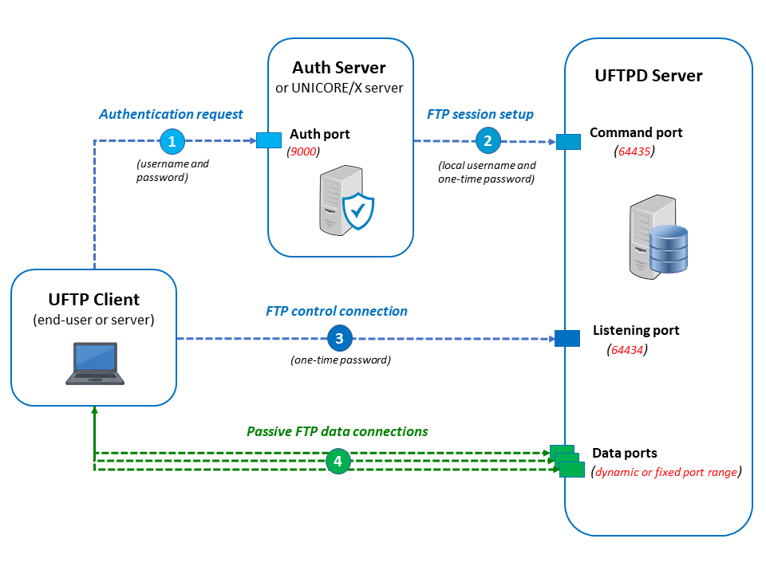
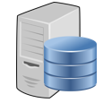

.. _uftp-howto-test:

|user-guide| How-To Install UFTP for Testing
********************************************

|overview-img| Overview
-----------------------

This guide describes how to set up a complete UFTP test environment
consisting of a UFTPD server, an Auth server, and a UFTP client. The
setup uses the **test** certificates provided with the distribution
packages. All components can be installed on a single machine, making
the setup suitable for evaluation and functional testing.

.. warning::

   This setup is intended **for testing only**. The included certificates
   are not suitable for production use. Production deployments must use
   certificates issued by **a trusted Certificate Authority (CA)**.

|checklist-img| Prerequisites
-----------------------------

- Java 17 or later (OpenJDK recommended)

- Python 3.9 or later

- The Auth server port (default: ``9000``) must always be reachable
  from the client through the firewall.

- The UFTPD command port (default: ``64435``) must be accessible
  from the Auth server.

- The UFTPD server's listening port (default: ``64434``) must always
  be reachable by the client through the firewall.

- The UFTPD server's data ports must also be accessible. If stateful
  firewall inspection is available, configure the firewall to track
  FTP connections on the listening port (dynamic ports). Alternatively,
  configure and open a fixed range of data ports.

- For encrypted data transfers, the Python *Crypto* module is required.
  It can be installed using:

  .. code:: console

     python3 -m pip install pycryptodome

Authentication and File Transfer Flow
-------------------------------------

In this setup, the UFTP client authenticates using only a username and
password. No client certificate is required.

.. list-table::
   :header-rows: 1
   :widths: 20 22 28 30

   * - File
     - Location
     - Purpose
     - Notes
   * - 👤 ``user-authfile.txt``
     - Auth Server
     - User authentication database
     - Text file for authentication
       [username:hashedpassword:salt:DN]
   * - 👥 ``user-mapfile.json``
     - Auth Server
     - Maps authenticated user to a local account
     - JSON file for authorization
   * - ⚙️ ``container.properties``
     - Auth Server
     - Auth Server configuration
     - Text file containing the Auth Server configuration
   * - 🔐 ``auth.p12``
     - Auth Server
     - Auth Server certificate
     - PKCS#12 file containing the Auth Server certificate
       and private key
   * - 🛡️ ``cacert.pem``
     - Auth and UFTPD servers
     - CA certificate used to sign server certificates
     - Self-signed CA certificate
   * - 🔐 ``uftpd.pem``
     - UFTPD Server
     - UFTPD Server certificate
     - PEM file containing the UFTPD server certificate
   * - ⚙️ ``uftpd.conf``
     - UFTPD Server
     - UFTPD Server configuration
     - Text file containing the UFTPD Server configuration
   * - 🔑 ``uftpd.acl``
     - UFTPD Server
     - Access Control List (ACL)
     - Text file containing the distinguished names (DNs)
       of servers authorized to initiate UFTP transfers
   * - ⚙️ ``uftpd-ssl.conf``
     - UFTPD Server
     - UFTPD SSL/TLS configuration
     - Text file containing the SSL/TLS configuration,
       including the UFTPD credential and trusted CA certificate

The authentication and file transfer process works as follows:

1. The client sends an authentication request containing its username
   and password to the Auth server. The Auth server validates the
   credentials using ``user-authfile.txt`` and maps the authenticated
   user to a local account using ``user-mapfile.json``.

2. If authentication is successful, the Auth server sends a request
   to the UFTPD command port. This request configures the upcoming
   file transfer and includes the following information:

   - A generated one-time password
   - The local user ID and group ID
   - The client's IP address

   The UFTPD server stores this information and accepts an incoming
   client connection only if the supplied one-time password matches
   the expected value. The Auth server then replies with ``OK`` and
   returns the generated one-time password to the client.

3. The UFTP client connects to the UFTPD server using the standard
   FTP protocol. It authenticates with the one-time password received
   from the Auth server.

4. Once authentication succeeds, the client can open data connections,
   list files, transfer data, and perform other FTP operations.

|config-img| Installation and Configuration
--------------------------------------------

Set up the complete test environment by installing the following
components:

1. Install and run a UFTPD server as described in
   :ref:`UFTPD Server Installation <uftpd-test-installation>`.

2. Install and run an Auth server as described in
   :ref:`Auth Server Installation <authserver-test-installation>`.

3. Install the UFTP client as described in
   :ref:`UFTP Client Installation <uftp-client-installation>`.

All components can be installed on the same machine for testing
purposes.

.. _uftpd-test-installation:

|uftpd-server-img| UFTPD Installation using Test Certificates
~~~~~~~~~~~~~~~~~~~~~~~~~~~~~~~~~~~~~~~~~~~~~~~~~~~~~~~~~~~~~

This section describes how to install the UFTPD server using the
**test certificates** included in the distribution package.

1. Download the ``.tar.gz`` distribution from
   `GitHub <https://github.com/UNICORE-EU/uftpd/releases>`__
   and unpack the package in your installation directory:

   .. code:: console

      tar -xvf unicore-uftpd-<release>.tar.gz

   Check the file permissions. All files in the ``conf`` and ``lib``
   directories must be **readable** by the user specified as
   ``USER_NAME`` in :file:`conf/uftpd.conf`. The scripts in ``bin``
   and all subdirectories must also be **executable** by this user.

   Ensure that a system user matching the configured ``USER_NAME``
   (for example, ``unicore``) exists. If necessary, edit the
   configuration to match your current system username.

2. Configure :file:`conf/uftpd-ssl.conf` to use the provided
   **test keystore and truststore**:

   .. code:: text

      credential.path=conf/uftpd.pem
      credential.password=the!uftpd
      truststore=conf/cacert.pem

   Ensure that the ``uftpd.pem`` and ``cacert.pem`` files are present
   in the ``conf`` directory. If they are missing, download them from
   the source package available on
   `GitHub <https://github.com/UNICORE-EU/uftpd/releases>`__.
   Unpack the ``.tar.gz`` or ``.zip`` package and check the ``test``
   directory for the files.

3. Start the UFTPD server with **root** privileges.

   **Option 1: Run directly with sudo**

   .. code:: console

      sudo <uftpd-installation-dir>/bin/unicore-uftpd-start.sh

   **Option 2: Switch to a root shell**

   (Recommended if logging to stdout; see Step 5.)

   .. code:: console

      sudo su -
      cd <uftpd-installation-dir>
      ./bin/unicore-uftpd-start.sh

4. Verify the server status. You can check whether the server is
   running by invoking the status script, which displays the current
   status and PID:

   .. code:: console

      ./bin/unicore-uftpd-status.sh

   If successful, the output will show:

   ``UNICORE UFTPD running with PID xxxxxxx``.

5. Logging (optional). Monitor the system logs to verify operation:

   .. code:: console

      sudo journalctl -f

   * **For detailed debugging:** Set ``export LOG_VERBOSE=true`` in
     :file:`conf/uftpd.conf`.

   * **To print logs to stdout:** Set ``export LOG_SYSLOG=false`` in
     :file:`conf/uftpd.conf`.

   .. important::

      If you disable syslog, the server might **fail to start** when
      using ``sudo``. This is because the process switches to the
      configured ``USER_NAME`` and may lose permission to write to
      the root terminal's stdout. To fix this, start the server from
      a real root shell (Option 2 in Step 3).

.. _authserver-test-installation:

|auth-server-img| Auth Server Installation using Test Certificates
~~~~~~~~~~~~~~~~~~~~~~~~~~~~~~~~~~~~~~~~~~~~~~~~~~~~~~~~~~~~~~~~~~

This section describes how to install and configure the Auth server
using the **test** certificates included in the distribution package.

1. Download the ``unicore-authserver-<release>.tar.gz`` file from
   `GitHub <https://github.com/UNICORE-EU/uftp/releases>`__
   and unpack the package in your installation directory:

   .. code:: console

      tar -xvf unicore-authserver-<release>.tar.gz

   Check the file permissions. All files must be **readable**,
   and all subdirectories and scripts in the ``bin`` directory must
   be **executable** by the user running the Auth server (for example,
   the ``unicore`` user or your current account).

2. Configure :file:`conf/container.properties` to use the provided
   **test keystore and truststore**:

   .. code:: text

      container.security.credential.path=certs/auth.p12
      container.security.credential.password=the!auth
      container.security.truststore.directoryLocations.1=certs/trusted-certs/*.pem

   If your UFTPD server is running on a different host, configure
   the following setting in :file:`conf/container.properties` to
   specify the publicly accessible hostname or IP address of the
   UFTPD server:

   .. code:: text

      authservice.server.TEST.host=<your-server-ip-address>

3. Edit ``user-mapfile.json`` to map the demo certificate to a local
   system account. Ensure that the ``xlogin`` value matches an
   existing local username (for example, ``unicore`` or your current
   username):

   .. code:: json

      {
        "CN=Demo User,O=UNICORE,C=EU": {
          "role":   "user",
          "xlogin": [ "unicore" ]
        }
      }

4. Start the Auth server:

   .. code:: console

      ./bin/unicore-authserver-start.sh

5. Check the server status:

   .. code:: console

      ./bin/unicore-authserver-status.sh

   The output should show:

   ``UNICORE service AUTHSERVER running with PID xxxxxx``.

6. Review the logs. Check :file:`authserver-startup.log` and
   :file:`authserver.log` in the ``logs`` directory for startup
   messages and any errors.

7. Verify the installation using curl. By default, the Auth server
   listens on **port 9000** (configured by ``container.port`` in
   ``container.properties``). If the server is running locally,
   execute:

   .. code:: console

      curl -k https://localhost:9000/rest/auth \
           -H "Accept: application/json" \
           -u demouser:test123

   This command should return a JSON document containing the status
   of the configured UFTPD servers.

.. _uftp-client-installation:

|uftp-client-img| UFTP Client Installation
~~~~~~~~~~~~~~~~~~~~~~~~~~~~~~~~~~~~~~~~~~

The UFTP client distribution packages are available from
`GitHub <https://github.com/UNICORE-EU/uftp-javaclient/releases>`__.

If using the ``zip`` archive, unpack it in a location of your choice.
Add the ``bin`` directory to your PATH. Alternatively, you can create
a symbolic link to or copy the ``bin/uftp`` script to a directory
that is already on your PATH. In this case, edit the script and
configure the required directories.

If you use the ``rpm`` or ``deb`` package, install it using the
package manager of your Linux distribution.

|testing-img| Testing the Installation
--------------------------------------

To verify that the installation was successful, run the functional
and performance tests described in :ref:`uftpd_test`. These tests use
the UFTP client to connect to the Auth server and the UFTPD server
and verify authentication, file transfers, and performance.

|support-img| Troubleshooting
-----------------------------

Authentication failures
~~~~~~~~~~~~~~~~~~~~~~~

Check:

* The username and password.
* The entries in :file:`conf/user-authfile.txt`.
* The user mapping in :file:`conf/user-mapfile.json`.
* The Auth server logs (``logs/authserver-startup.log`` and
  ``logs/authserver.log``).

ACL errors
~~~~~~~~~~

Check:

* The certificate DNs in :file:`conf/uftpd.acl`.

Certificate trust problems
~~~~~~~~~~~~~~~~~~~~~~~~~~

On the Auth server, verify:

* ``certs/auth.p12``
* ``certs/trusted-certs/cacert.pem``

On the UFTPD server, verify:

* ``conf/uftpd-ssl.conf``
* ``conf/uftpd.pem``
* ``conf/cacert.pem``

Also verify:

* Certificate validity.
* Certificate subjects.
* Matching CA certificates.

Permission denied errors
~~~~~~~~~~~~~~~~~~~~~~~~

Verify:

* ``conf/uftpd.conf``
* Directory permissions.
* The configured ``USER_NAME``.
* That the Unix user exists.

.. raw:: html

   

